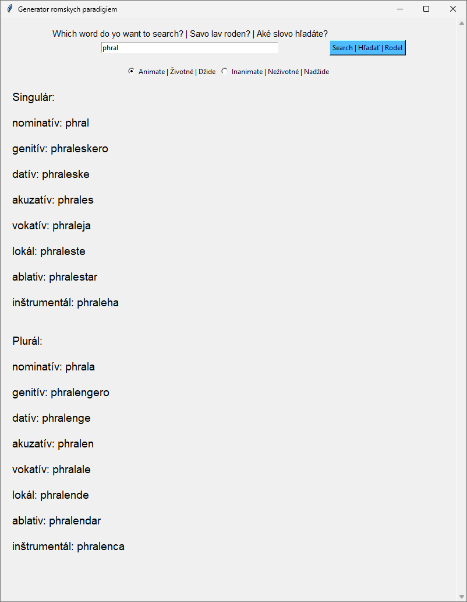

# Roma Paradigm Generator (RPG)

[](https://github.com/ingMychal/roma-paradigm-generator/actions/workflows/ci.yml)

Generates declension and conjugation tables (paradigms) for East Slovak Romani words. It works offline, as an extension of [romskyslovnik.online](https://romskyslovnik.online/), and supports nouns and verbs.

> **Disclaimer:** the dictionary data behind this project is not owned by the author. The repository ships only a small sample, `roma_paradigm_generator/data/SRO.sample.xml`, for demonstration.



## Table of contents

- [Requirements](#requirements)
- [Usage](#usage)
- [Using the full dictionary](#using-the-full-dictionary)
- [How it works](#how-it-works)
- [Development](#development)
- [Building an executable](#building-an-executable)
- [Project layout](#project-layout)

## Requirements

- Python 3.9 or newer, with Tk (`tkinter`) for the window. The python.org installers include Tk; on Linux you may need a package such as `python3-tk`.
- No other packages are needed to run the application.

## Usage

Open the window from the repository root:

```bash
python -m roma_paradigm_generator
```

Type a word, for example `phral`, choose its animacy (here animate, *Životné*), and press Enter or click the search button.

Or print the paradigms in the terminal:

```bash
python -m roma_paradigm_generator phral --animate
```

Options:

| Option | Meaning |
|---|---|
| `--animate` | decline a noun as animate (the default is inanimate) |
| `--dictionary PATH` | use another SRO XML file |
| `--version` | print the version |

Words are found regardless of case and diacritics, so `dzuvli` finds `džuvľi`. A verb phrase such as `dikhel pes` is conjugated as a whole, and `pes` becomes the matching pronoun (`man`, `tut`, `pes`, `amen`, `tumen`, `pen`).

To install the `roma-paradigm-generator` command instead:

```bash
pip install .
```

## Using the full dictionary

Put the full SRO export at `roma_paradigm_generator/data/SRO.xml`. The application uses it when it is there, and the sample otherwise. Git ignores that file, so it cannot be committed by accident.

## How it works

1. `dictionary.py` reads the XML once and finds the word, its part of speech and its gender.
2. `nouns.py` builds the oblique stems, decides whether the noun is oikoclitic (inherited) or xenoclitic (a loanword), and builds all eight cases in singular and plural. Exceptions to the rules live in `noun_exceptions.py`.
3. `verbs.py` picks the conjugation class from the ending (-al, -el, -ol), builds the present and perfect stems, and adds the endings from `verb_endings.py`. When no rule covers a verb's perfect stem, the table shows `xxx` in its place.
4. `generator.py` joins these steps; `gui.py` and `cli.py` only display the result.

## Development

```bash
python -m venv .venv
source .venv/bin/activate        # Windows: .venv\Scripts\activate
pip install -r requirements.txt
python -m pytest
```

The tests cover:

- the dictionary lookup, against a small test dictionary in `tests/data/test_dictionary.xml`;
- hand-checked noun forms in `tests/data/*.csv` and hand-checked verb forms in `tests/test_verbs.py`;
- the command line and the window (the window tests skip themselves where no display is available);
- a regression snapshot, `tests/data/golden_paradigms.json`, of the current output for about 40 nouns and 30 verbs. It catches accidental changes; it is not a linguistic reference. After you change a rule on purpose, regenerate it and review the diff:

  ```bash
  python -m tests.test_golden
  ```

GitHub Actions runs the tests on Linux, macOS and Windows, installs the package, and builds the executable on every push to `main` and every pull request.

## Building an executable

```bash
pip install -r requirements.txt
python build_script.py
```

The script runs the tests first and stops if any fail. The executable appears in `dist/` as `RomaParadigmGenerator` (`RomaParadigmGenerator.exe` on Windows). It contains the full dictionary when it is present, otherwise the sample.

PyInstaller builds only for the system it runs on: build on Windows for Windows, on macOS for macOS, and on Linux for Linux.

## Project layout

```text
roma_paradigm_generator/   the application
  data/SRO.sample.xml      sample dictionary (the full SRO.xml goes next to it)
tests/                     pytest tests and their data
docs/images/               screenshots for this README
build_script.py            builds the standalone executable
```
